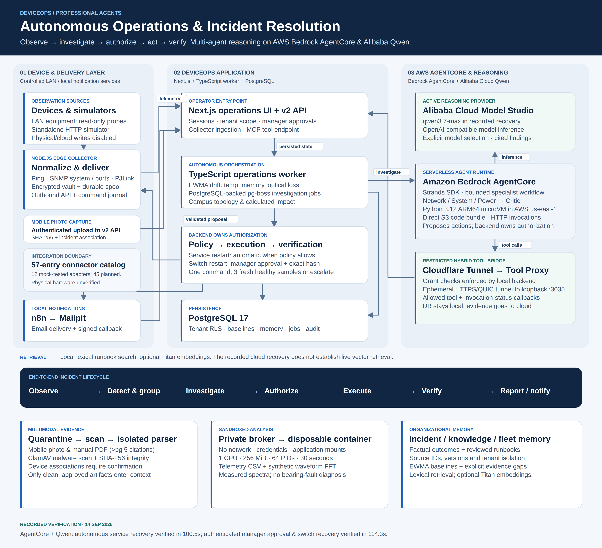

# DeviceOps architecture



[High-resolution PNG](diagrams/deviceops-architecture.png) · [Editable SVG](diagrams/deviceops-architecture.svg) · [Single-page PDF](diagrams/deviceops-architecture.pdf)

Updated September 14, 2026 to describe the implemented hybrid demonstration.
The diagram separates local application services, AWS-hosted Strands execution,
and Alibaba Cloud model inference. It does not claim the whole application is
hosted on AWS or that AgentCore uses Bedrock model inference.

## Data flow and deployment

1. **Collect.** The Node.js collector normalizes enrolled device observations and
   delivers them to the tenant-scoped API. Real equipment is read-only; actions
   are restricted to enrolled simulators. Built-in demo scenarios update backend
   state independently of the collector. Mobile photos upload directly to the API.
2. **Detect.** The local Next.js application, TypeScript worker, PostgreSQL and
   pg-boss support incident detection, topology grouping and durable jobs. The
   diagram's persisted-state connection represents shared database state, not
   a direct API-to-worker network call.
3. **Investigate.** The local bridge selects AgentCore using
   `STRANDS_TRANSPORT=agentcore`. Strands runs in the AWS Python runtime and
   routes to relevant Network, System, and Power specialized sub-agents, followed
   by Critic sub-agent audit and final synthesis. Alibaba Model Studio supplies
   Qwen inference; specialists are sub-agent orchestration in Strands, not separate
   Alibaba services. Explicit model selection does not guarantee deterministic model output.
4. **Retrieve evidence.** Cloud callbacks traverse Cloudflare to the loopback
   proxy on port 3035. The proxy restricts POST requests to the internal tools
   and invocation-status endpoints; the backend validates scoped grants. The
   database and simulators stay local, but selected incident telemetry and
   investigation evidence leave the machine for Cloudflare, AgentCore and Qwen.
   Credentials are not intended model inputs. Local services and the tunnel
   must remain available for this demonstration.
5. **Authorize and recover.** Backend policy, not the critic or model, authorizes
   simulator actions. Service restart can be automatic; switch restart requires
   manager approval bound to the proposal hash. Command acknowledgment alone
   is insufficient: three fresh healthy observations confirm recovery, while
   failed verification escalates. Local n8n/Mailpit demonstrate notification
   delivery and signed callbacks; Mailpit is a test mailbox.

## Five capabilities and boundaries

- **Specialist reasoning:** bounded Strands multi-agent workflow with specialized sub-agents,
  scoped evidence tools, critic sub-agent audit, and backend policy enforcement. Only relevant sub-agents
  need run; the diagram does not promise four separate calls every time.
- **Anomalies:** deterministic EWMA/threshold/trend detection with temperature,
  memory and optical-loss examples using synthetic telemetry. This is not a
  validated failure-time forecasting model.
- **Evidence:** photo/PDF processing, quarantine/scanning, citations and confirmed
  device associations. Mobile capture, local SHA-256 hashing, ClamAV quarantine
  scanning, and device confirmation are verified on an attached physical Android phone.
- **Analysis:** local broker and disposable container with bounded resources,
  no network or service credentials, CSV charts and synthetic waveform FFT.
  Spectral differences do not establish a hardware-fault diagnosis. This is
  not a claim of deployed AgentCore Code Interpreter.
- **Memory:** tenant-scoped incident outcomes, reviewed runbooks and baselines.
  Local lexical retrieval is distinct from optional Titan/vector integration;
  the cloud recovery record does not establish live vector retrieval.

The catalog has 57 entries: 12 implemented catalog adapters with mock/protocol
fixture coverage and 45 planned entries. The standalone HTTP simulator is an
additional adapter. Physical vendor hardware compatibility remains unverified.
This reconciles the earlier documentation's outdated four-adapter count.

## Recorded cloud verification

Sources: [bounded service recovery record](verification/agentcore-bounded-recovery.json) · [manager approval recovery record](verification/agentcore-switch-approval.json).

- Runtime: `deviceops_strands_bounded-22yEC79ykp`, AWS `us-east-1`.
- Packaging: direct S3 code bundle, Python 3.12 ARM64 runtime.
- Autonomous recovery: simulator service hang; automatic `restart_service`; resolved after
  three healthy observations. Recorded duration: **100.5 seconds**.
- Human approval recovery: simulator switch failure; multi-agent specialist diagnosis;
  `restart_switch` proposal with `approval_required` risk; pre-approval zero commands verified;
  authenticated manager decision via API; simulator execution; resolved after three healthy
  observations. Recorded duration: **114.3 seconds**.
- Cancellation safety and repeated-request cleanup remain documented limitations.
- The earlier 51.91-second record covers diagnosis and a recommended action;
  it must not be described as completed recovery.

Cold-start latency and ongoing availability are not established by this record.
No zero-cost or unlimited-quota guarantee is made. See
[AgentCore implementation limitations](verification/AGENTCORE_HARDENING.md).
Existing v1 pages remain available alongside the v2 operations workflow.

## Maintenance

Regenerate all formats together:

```sh
python3 docs/diagrams/build_architecture.py
node docs/diagrams/render_diagram.mjs
```

The renderer uses installed Playwright/Chromium, creates a 3600 × 3280 PNG and
single-page PDF, and checks SVG text bounds. No Docker build or live inference
is required. Update verification claims only from corresponding result records.
