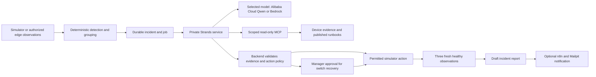

# DeviceOps operations runbook

## Outcome and current boundary

The implemented workflow is fault/observation → durable incident → scoped investigation → evidence-backed diagnosis → backend action policy → approval when required → simulator execution → fresh recovery verification → draft report and optional notification.

The web dashboard and simulator workflow run independently of hardware. `OPS_AGENT_MODE=fixture` is a deterministic demonstration, clearly labelled in the UI; it is useful for setup and tests but is not evidence that live reasoning was invoked. `OPS_AGENT_MODE=qwen` or `OPS_AGENT_MODE=bedrock` uses the private Python service with explicit provider selection. See [Qwen setup](QWEN.md). Gemini has been retired. Do not describe live reasoning or model evaluation as verified until that path has actually run with funded credentials.

The wider ideas remain visible in the [57-entry integration catalog](INTEGRATIONS.md). The application currently has read-only core protocol adapters and simulator actions. Hardware remediation, all vendor cloud/server integrations, scanned-document OCR and regulated-environment guarantees are not implemented claims. The bounded specialist, media, analysis, memory and mobile extensions are described in [verification records](verification/) and [photo/acoustic guide](ACOUSTIC_AND_MOBILE.md).



## Local fixture stack

The [root README](../README.md) gives the complete Compose sequence. The generated `.env.demo` is private, ignored by Git, and never overwritten by the generator. The standalone stack keeps its existing project identity and database volumes. The UI is bound to localhost port 3030, and PostgreSQL is internal to the Compose network. Existing development services on port 3000 are unaffected.

```sh
node scripts/demo-env.mjs
node scripts/demo-preflight.mjs
docker compose --env-file .env.demo -f compose.demo.yaml up -d postgres
docker compose --env-file .env.demo -f compose.demo.yaml run --build --rm migrate
docker compose --env-file .env.demo -f compose.demo.yaml run --rm seed
docker compose --env-file .env.demo -f compose.demo.yaml -f compose.enterprise.yaml -f compose.media-scan.yaml up -d --build web worker
```

Build the sandbox image first with `docker build -t deviceops-analysis:local apps/analysis-sandbox`. The enterprise/scanner overlays start the private broker and ClamAV. Allow the scanner to become healthy before uploading phone photos.

Sign in at `http://localhost:3030` with `usamaaslam8726@gmail.com` and the private generated `SEED_PASSWORD`, then visit `/operations`. Admin, manager, and technician fixture roles are also created. Use a manager for approvals; technician action attempts must be denied. A second tenant exists for isolation checks.

`seed` resets fixture users/passwords and legacy diagnosis test data: run it only against a disposable demo database. Avoid deleting Docker volumes when stopping the stack. To inspect an issue:

```sh
docker compose --env-file .env.demo -f compose.demo.yaml ps
docker compose --env-file .env.demo -f compose.demo.yaml logs --tail 80 web worker
```

For host-run development, configure `.env` from `.env.example` with local database addresses and generated secrets; do not run a second worker against the same demonstration while another is intentionally performing tests.

```sh
node --env-file=.env --import tsx scripts/migrate.ts
node --env-file=.env --import tsx scripts/seed.ts
```

Start web and worker in separate terminals after loading the trusted local environment, or use Node's `--env-file=.env` on these direct commands:

```sh
node --env-file=.env apps/web/node_modules/next/dist/bin/next dev apps/web --webpack
node --env-file=.env --import tsx apps/worker/src/index.ts
```

The worker Compose command uses `node --import tsx` directly, so it does not require an environment file inside its image. Docker supplies its variables.

## Live Strands and credits

1. Configure the intended AWS account and region.
2. Confirm funding, any applied credits, expiry and service coverage in AWS Billing before enabling paid calls.
3. Verify model availability for Nova Lite (`us.amazon.nova-lite-v1:0`) and Titan V2 (`amazon.titan-embed-text-v2:0`) in the intended account/region.
4. Set `AWS_CREDITS_CONFIRMED=true` only after those funding checks. Backend and Python paid routes otherwise reject inference/embedding. This flag is an attestation; it cannot query or guarantee your AWS balance.
5. Configure the private Strands service and grant it only required Bedrock permissions. Keep device/database credentials out of model tools.

For local Compose, add these settings to private `.env.demo` after verification:

```dotenv
OPS_AGENT_MODE=bedrock
AWS_CREDITS_CONFIRMED=true
AWS_CREDIT_BALANCE_USD=50
BEDROCK_ACCESS_CONFIRMED=true
AWS_REGION=us-east-1
AWS_SHARED_CREDENTIALS_FILE=/absolute/path/to/private/aws-credentials
AWS_PROFILE=default
```

The file contains ordinary AWS shared credentials and is mounted read-only into the Strands container as a Compose secret; do not commit or paste it. Temporary credentials require their session token and must be refreshed when they expire. For a host-run service or EC2 instance role, use the [Python service instructions](../apps/strands-agent/README.md) instead; EC2 should use its role rather than a credential file.

```sh
node scripts/demo-preflight.mjs
docker compose --env-file .env.demo -f compose.demo.yaml --profile bedrock up -d --build strands web worker
```

Starting the funded worker allows subsequent incident jobs to invoke paid models. Root model-budget reservations and Python limits bound individual work; AWS budget alerts are not a hard stop. Do not leave an unbounded public scenario trigger enabled. Model errors stay visible; there is no hidden fixture fallback.

## Reproducible scenarios

| Scenario | Required visible result |
| --- | --- |
| Upstream switch failure | Explicit topology groups affected downstream devices; switch restart awaits manager approval; target and dependents recover before resolution |
| Telemetry service hang | Reachability stays separate from application error; only the named simulator service can recover automatically |
| Authentication failure | Warning explains credentials; it is not recast as established device unreachability; no restart fixes the missing authentication |
| Source conflict | Timestamp/provenance remain visible; stale evidence does not silently override fresh health |
| Recovery failure | Command acknowledgment does not resolve the incident; continued unhealthy observations eventually escalate |

Reset between scenarios. Fault injection only changes simulator state; worker detection creates the incident. Record detection, investigation, approval waiting, execution, and verification timing separately. Do not turn targets into claims such as "under 60 seconds" without measurements.

## Optional local notifications

The companion repository contains `workflows/operations_notification.json`. Start the local notification profile:

```sh
docker compose --env-file .env.demo -f compose.demo.yaml --profile notifications up -d n8n mailpit
```

Open `http://localhost:15678`, create the local n8n owner account, import that workflow, save a small node change in the editor to create a history revision, and publish it. The n8n 2.0 CLI import alone does not create the history version required by `publish:workflow`. The workflow is deliberately shipped inactive. The n8n container already receives the backend URL, Mailpit URL, HMAC secret, and `.test` sender/recipient configuration. Set `OPS_N8N_WEBHOOK_URL=http://n8n:5678/webhook/operations-envelope` in `.env.demo`, then recreate the web and worker services. Run the local delivery probe below, then check the trapped message at `http://localhost:18025` after an incident report is produced.

Run the probe from a rebuilt image that contains the current script:

```sh
docker compose --env-file .env.demo -f compose.demo.yaml exec worker node --import tsx scripts/ops-notifications-live.mts
```

The workflow must demonstrate actual core → n8n → Mailpit → signed callback delivery. Notification acknowledgment and recovery resolution are separate. Unknown delivery outcomes are not blindly retried, and a notification cannot authorize a device action. Real external recipients/channels require separate configuration and authorization.

## Verification record and release gates

Recorded checks are in [verification records](verification/). UI fixtures, real local API/container checks, physical-phone checks and live-provider checks establish different boundaries. A successful build is not evidence of live model authorization.

Checks before preparing a release:

```sh
npm run typecheck
npm test
npm run build --workspace @deviceops/web
apps/strands-agent/.venv/bin/python -m pytest apps/strands-agent/tests -q
apps/strands-agent/.venv/bin/python apps/strands-agent/export_schemas.py --check
```

Run the checked-in operations/database and browser integration scripts against an isolated seeded instance. Confirm all scenarios, cross-tenant grants/observations, changed/expired approvals, duplicate and concurrent execution, crash/lease recovery, notification callback authenticity, and cost-budget exhaustion. Live Bedrock evaluations and public demonstration access remain separate release gates requiring funded credentials and deployment verification.

## Current implementation details

Operational v2 records are separate JSONB records in `ops_records`, protected by tenant RLS and a tenant advisory lock; this is a prototype storage model, not a fully normalized large-fleet schema. Observation reads are ordered by event time, writes are batched, and hot history is bounded. Incident reports retain cited evidence. Metrics are individual scalar values; connector port data is flattened into bounded field paths.

Runbook search combines lexical ranking with cosine similarity and reciprocal-rank fusion when Titan vectors have been indexed. The current small-corpus path stores vectors on runbook records and evaluates similarity in the service; it does not claim an optimized pgvector/FTS query plan. Indexing handles batches of 16 and at most the first 4,000 characters of each runbook. Lexical fallback is returned explicitly if semantic retrieval is unavailable. Managers review and publish report-derived runbooks; model text cannot publish itself.

The external read-only MCP mode uses `DEVICEOPS_URL` and `DEVICEOPS_MCP_ACCESS_TOKEN` (an existing DeviceOps user session) to expose `list_incidents` and `get_triage_report`. It has no database credential and rejects caller-provided tenant overrides. The original invocation-grant mode exposes seven bounded investigation tools; the specialist workflow also uses the scoped analysis tool when enabled. Both modes share the existing stdio entry point. Keep tokens in private environment configuration, never in checked-in MCP JSON.

The simulator action policy allows only named service/switch actions with empty arguments. Physical/cloud remediation is disabled. Collector commands are claimed once, journaled before execution, reconciled after a crash, and never blindly replayed when the outcome is unknown. Three post-command healthy samples are required. Model and embedding reservations have durable expiry/recovery records; an uncertain outcome retains its conservative charge estimate.

For reproducible local verification, the scripts below use only the configured disposable database and local test recipients. Set `DATABASE_URL`, `DATABASE_ADMIN_URL`, `OPS_TEST_URL` and the private seed password in `OPS_TEST_PASSWORD` first. Never target a client or production database with integration fixtures.

```sh
node --import tsx scripts/ops-integration.mts
node --import tsx scripts/ops-grants-integration.mts
node --import tsx scripts/ops-notifications-integration.mts
PLAYWRIGHT_BASE_URL=http://localhost:3030 npm run test:web:e2e -- tests/web/operations.spec.ts --workers=1
```

See [verification records](verification/) for recorded results and [UI checks](UI_MIGRATION.md) for browser coverage.
